<div align="center">


# RPM Builder

**Визуальный конструктор RPM-пакетов для Linux**

Нативное безрамочное приложение на **C++ / Qt 6 (QML)**: заполняете карточку пакета,
перетаскиваете файлы, нажимаете «Собрать» — `rpmbuild` запускается с автоматически
сгенерированным SPEC, готовый `.rpm` появляется в выбранном каталоге.

[](https://github.com/flytimopheev-sketch/rpm-builder/releases/latest)
[](https://www.qt.io/)
[](https://en.cppreference.com/w/cpp/20)
[](LICENSE)
[](https://github.com/flytimopheev-sketch/rpm-builder/releases/latest)
[](https://redos.red-soft.ru/)

**[Скачать Release v1.4.1](https://github.com/flytimopheev-sketch/rpm-builder/releases/latest)** ·
[Руководство (PDF, RU)](docs/guide/RPM-Builder-1.4.1-Guide-RU.pdf) ·
[Примеры](docs/examples/) ·
[CHANGELOG](CHANGELOG.md)

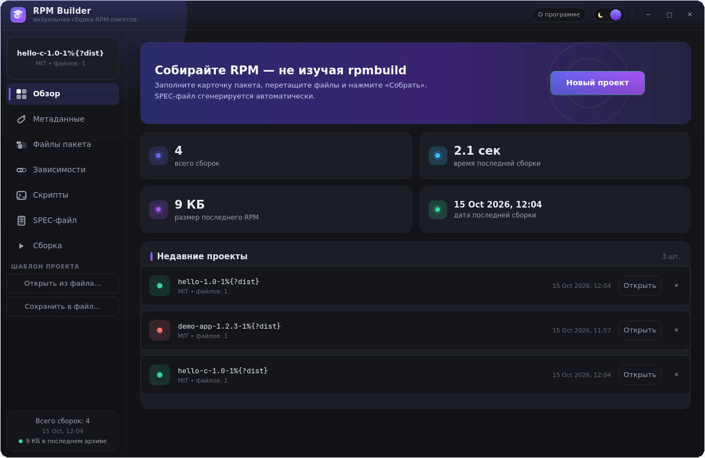

</div>

---

## Почему RPM Builder

Ручное редактирование `.spec` — частый источник ошибок: забытый `%files`, неверный макрос,
опечатка в Requires. RPM Builder закрывает эту рутину визуальным редактором: приложение
держит за вас весь конвейер — от метаданных и списка файлов до готовой команды `rpmbuild`,
с живым журналом сборки и понятным разбором ошибок. При этом сгенерированный SPEC всегда
можно посмотреть, скопировать или сохранить и использовать без приложения.

- **Никакого ручного SPEC** — форма генерирует корректный spec-файл в реальном времени
- **Сборка в один клик** — автоматическое развёртывание `BUILD/BUILDROOT/RPMS/SRPMS/SOURCES/SPECS`
- **Понятные ошибки** — строки ошибок из журнала собираются в карточку «Почему сборка не удалась» с подсказками
- **Работает офлайн** — всё локально, никакого облака; только локальный `rpmbuild`

## Возможности

| | |
|---|---|
| 🎨 **Безрамочный интерфейс** | кастомный заголовок с перетаскиванием (X11 и Wayland), скруглённые углы, плавные анимации; тёмная и светлая темы с запоминанием выбора |
| 📝 **Карточка пакета** | имя, версия, релиз, архитектура, лицензия (SPDX), URL, сводка, описание, packager/vendor; валидатор в реальном времени подсвечивает проблемные поля и объясняет, что не так |
| 📦 **Файлы drag&drop** | перетащите файлы и папки из проводника; каталог установки (`%{_bindir}`, `%{_unitdir}`, `/usr/share/applications`, …) подставляется автоматически |
| 🗂 **Встроенный FilePicker** | выбор файлов/папок и «Сохранить как» внутри окна приложения — работает на любом окружении (Wayland, порталы), без системных диалогов |
| 🔗 **Зависимости чипами** | Requires / BuildRequires / Provides |
| 🛠 **Сборка из исходников** | секции `%build` / `%install` / `%files` + скриплеты `%pre`/`%post`/`%preun`/`%postun` — компиляция Rust / Go / C / make прямо при сборке RPM, с кнопкой «Вставить пример» |
| 👁 **Живое превью SPEC** | перегенерируется при каждом изменении; копирование в буфер и сохранение |
| 🚀 **Сборка в один клик** | стриминг журнала с подсветкой ошибок/предупреждений, таймер, надёжная отмена (SIGTERM → SIGKILL) |
| 📊 **Артефакты и статистика** | готовые `.rpm` копируются в выбранный каталог; счётчики сборок, времени и размера |
| 💾 **Шаблоны и история** | JSON-шаблоны `*.rpmb.json` (переносимы, пути `~/...` раскрываются), до 12 недавних проектов, автосохранение черновика |

<table>
<tr>
<td>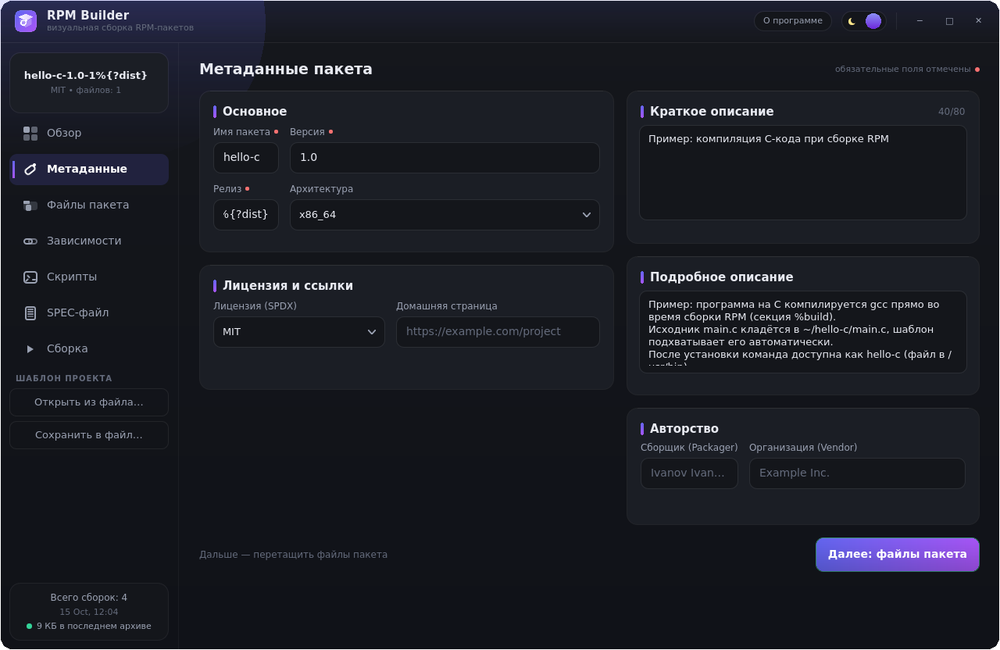</td>
<td>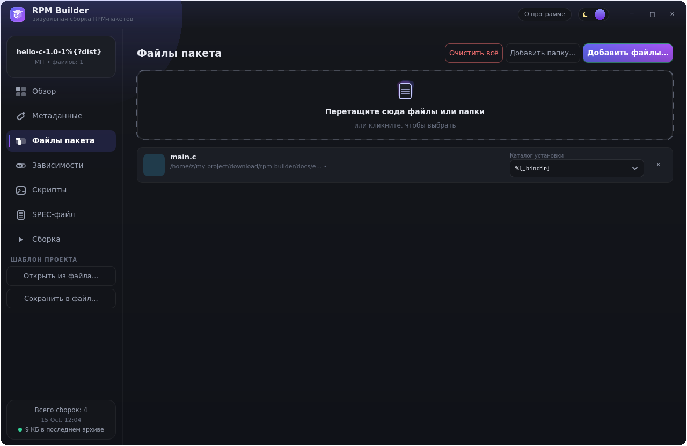</td>
</tr>
<tr>
<td>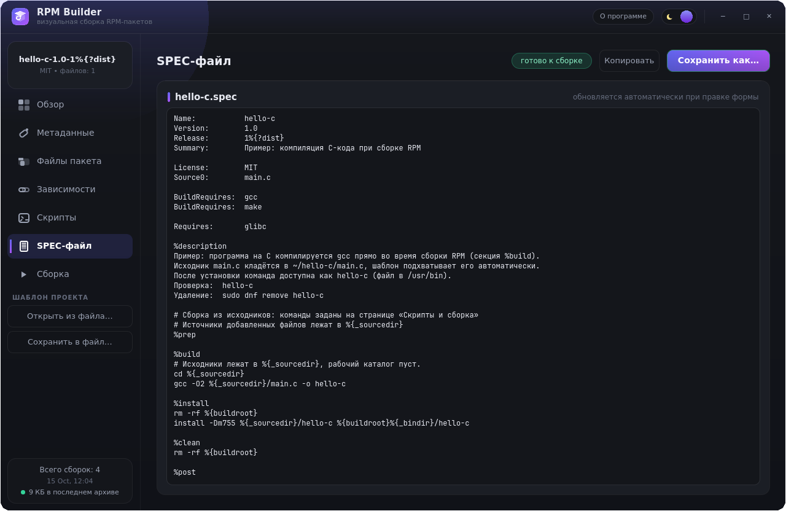</td>
<td>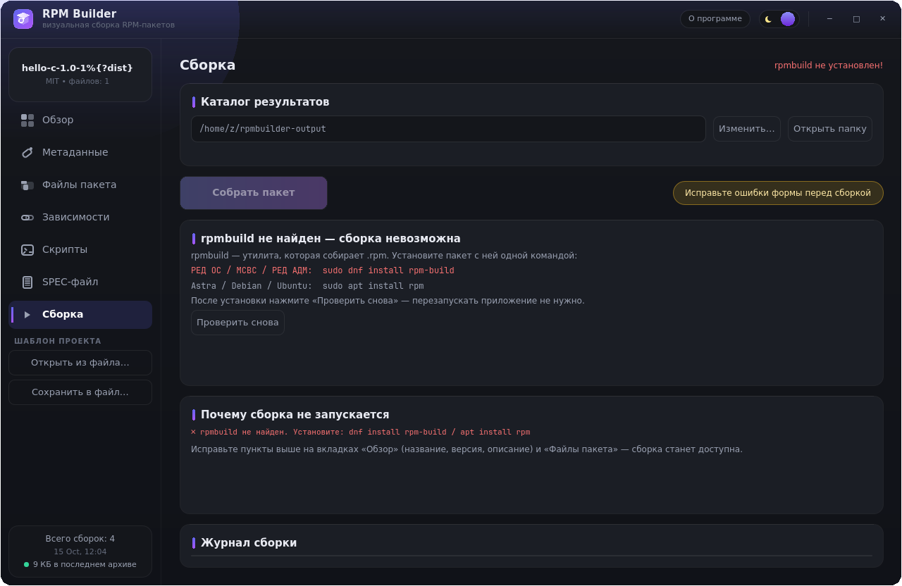</td>
</tr>
</table>

<details>
<summary><b>Больше скриншотов</b> (зависимости, скрипты, встроенный выбор файлов, светлая тема)</summary>

<table>
<tr>
<td>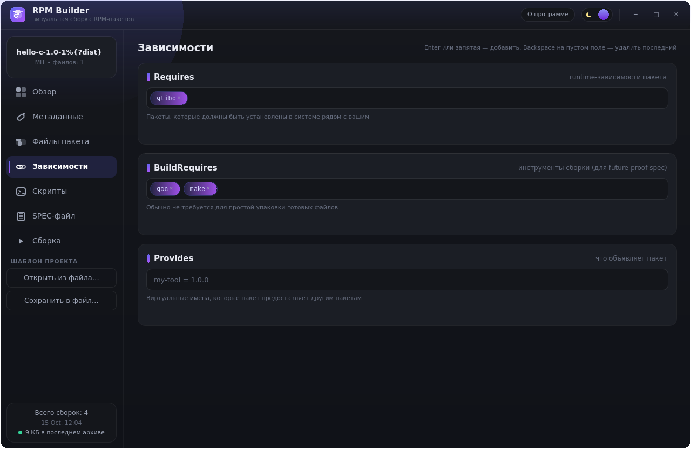</td>
<td>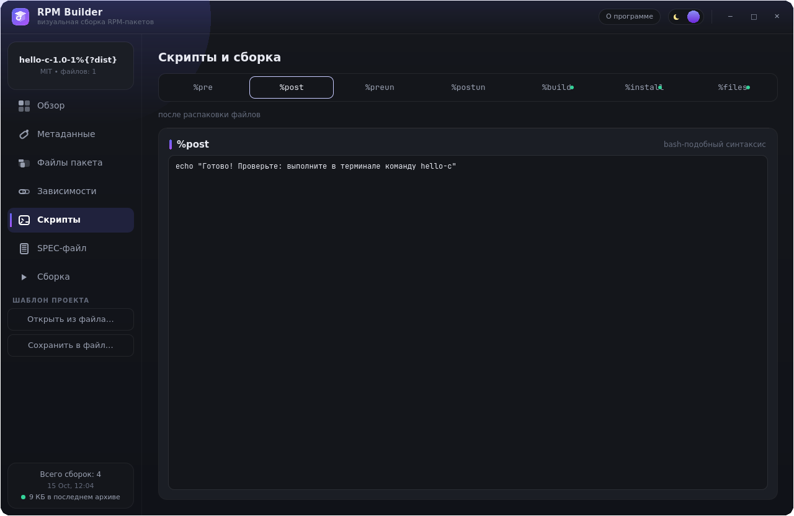</td>
</tr>
<tr>
<td>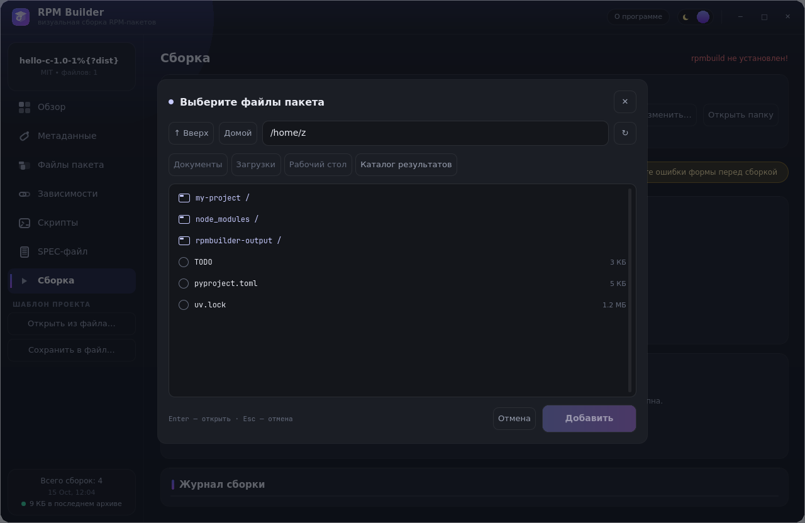</td>
<td>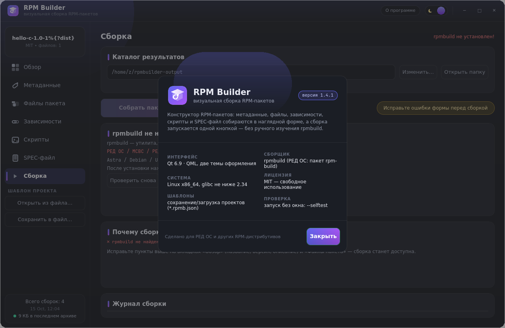</td>
</tr>
</table>

| Светлая тема | |
|---|---|
| 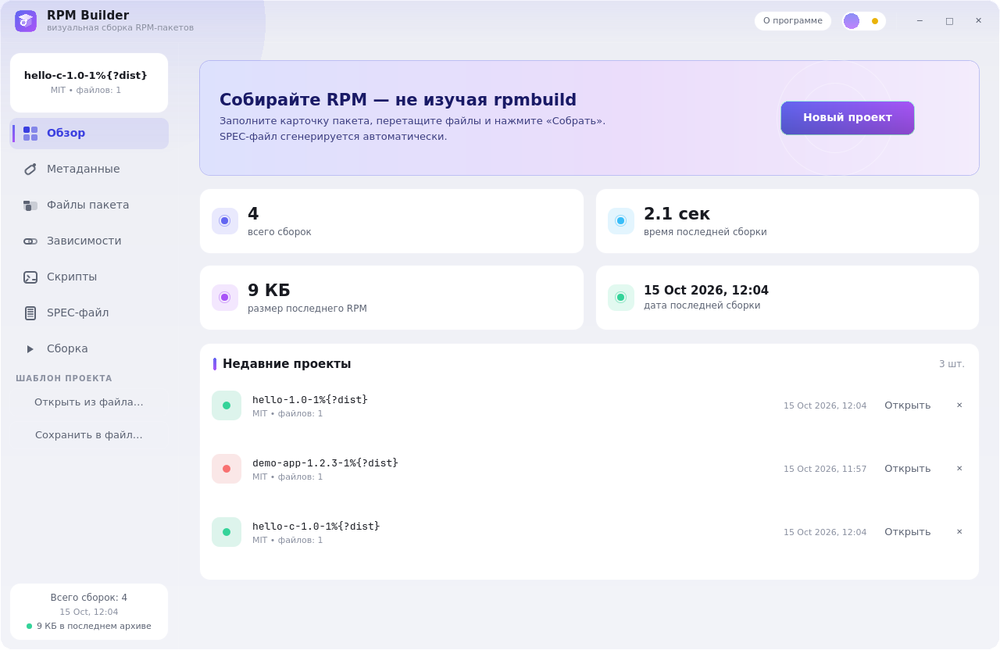 | 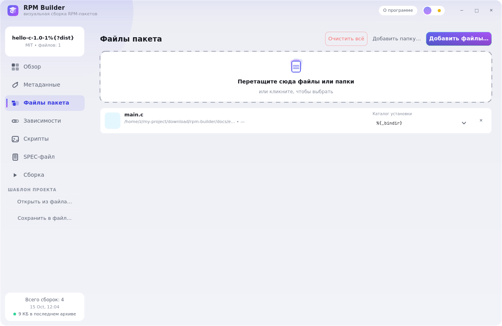 |

</details>

## Установка

### Готовые сборки — [Release v1.4.1](https://github.com/flytimopheev-sketch/rpm-builder/releases/latest)

**РЕД ОС / Fedora / RHEL-совместимые** (рекомендуется):

```bash
sudo dnf install ./rpm-builder-1.4.1-1.x86_64.rpm
```

Приложение появится в меню (**Разработка → RPM Builder**) и в терминале (`rpm-builder`).
Для сборки пакетов нужен `rpmbuild`: `sudo dnf install rpm-build` — если его нет,
приложение покажет понятную карточку с командой установки.

**Портативная версия** (без установки, свой Qt — только `glibc ≥ 2.34`):

```bash
tar -xzf rpm-builder-1.4.1-all-in-one.tar.gz
cd rpm-builder-1.4.1-all-in-one/portable && ./rpm-builder.sh
```

Всё, что скачиваете, проверяйте контрольными суммами: `sha256sum -c SHA256SUMS.txt`.

### Из исходников

```bash
git clone https://github.com/flytimopheev-sketch/rpm-builder.git
cd rpm-builder
./build.sh && ./build/rpm-builder        # или: cmake -B build -G Ninja && cmake --build build
sudo ./install.sh                        # установка в /usr/local
```

Зависимости: **Qt ≥ 6.5** (Quick, QuickControls2), компилятор с **C++20**, CMake ≥ 3.21.

| Дистрибутив | Команда |
|---|---|
| Debian / Ubuntu | `sudo apt install build-essential cmake ninja-build qt6-base-dev qt6-declarative-dev` |
| Fedora / РЕД ОС | `sudo dnf install gcc-c++ cmake ninja-build qt6-qtbase-devel qt6-qtdeclarative-devel` |
| Arch | `sudo pacman -S base-devel cmake ninja qt6-base qt6-declarative` |

## Как пользоваться

1. **Обзор → Новый проект** (или сразу «Метаданные») — заполните карточку пакета.
   Поля с красной точкой обязательны.
2. **Файлы пакета** — перетащите файлы/папки в пунктирную зону или нажмите
   «Добавить файлы» / «Добавить папку». Для каждого источника выберите каталог установки.
3. При необходимости — **Зависимости** и **Скрипты и сборка**. Готовые файлы кладутся
   в пакет автоматически; если проект нужно компилировать — заполните `%build`
   (см. [docs/examples/hello-c](docs/examples/hello-c/ПРОЧТИ-МЕНЯ.txt)).
4. **SPEC-файл** — проверьте автопревью; при желании сохраните `.spec`.
5. **Сборка** — выберите каталог результатов и нажмите «Собрать пакет». Журнал покажет
   все шаги; при ошибке карточка «Почему сборка не удалась» объяснит причины.

### Сборка проектов Rust / Go / C / make из исходников

| Секция | Назначение |
|---|---|
| `%build` | команды компиляции (`cargo build --release`, `go build`, `gcc`, `make`, `cmake --build`) |
| `%install` | что и куда положить в пакет; если пусто — авто-копирование файлов |
| `%files` | список файлов пакета; если пусто — составляется автоматически |

Схема: исходники добавляются на странице «Файлы» и попадают в `%{_sourcedir}`;
в `%build` — переход `cd %{_sourcedir}/имя_проекта` и сборка; toolchain объявляется
в **BuildRequires** (`cargo`, `golang`, `gcc`…). Готовые примеры:
[hello](docs/examples/hello/) (упаковка готового скрипта) и
[hello-c](docs/examples/hello-c/) (компиляция на C внутри `%build`) —
открываются в приложении и собираются сразу, без ручного копирования файлов.

## Служебные режимы

Полезны для CI и автоматизации:

```bash
rpm-builder --selftest            # демо-проект + JSON-roundtrip + полный конвейер сборки
rpm-builder --e2etest [шаблон]    # реальная сборка примера настоящим rpmbuild
rpm-builder --navtest             # навигация по страницам с сохранением данных
rpm-builder --picktest            # встроенный FilePicker (файлы/папка/save)
rpm-builder --canceltest          # отмена сборки (SIGTERM → SIGKILL)
rpm-builder --shots <dir>         # PNG всех страниц (offscreen) для регрессий
```

## Структура проекта

```
rpm-builder/
├── CMakeLists.txt              # Qt6/QML-модуль RpmBuilder, C++20
├── build.sh / install.sh / uninstall.sh
├── rpm-builder.spec            # упаковка самого RPM Builder в RPM
├── assets/
│   ├── rpm-builder.svg         # иконка приложения
│   ├── rpm-builder.desktop     # ярлык для меню
│   └── fonts/                  # Inter и JetBrains Mono (SIL OFL 1.1)
├── src/                        # C++-движок
│   ├── main.cpp                # входная точка (+ --selftest/--shots/--e2etest для CI)
│   ├── rpmbuildengine.h/.cpp   # состояние, снапшоты, настройки
│   ├── rpmproject.cpp          # файлы, история, валидация, генератор SPEC
│   ├── projectio.cpp           # JSON-шаблоны проектов (*.rpmb.json)
│   ├── rpmbuild.cpp            # конвейер rpmbuild через QProcess
│   └── glibc_compat.c          # совместимость со старыми glibc (РЕД ОС 8 и др.)
├── qml/                        # интерфейс
│   ├── Main.qml                # безрамочное окно, страницы, темы
│   ├── Theme.qml               # синглтон двух палитр
│   ├── components/             # тайтлбар, сайдбар, FilePicker, чипы, карточки…
│   └── pages/                  # Обзор, Метаданные, Файлы, Зависимости,
│                               # Скрипты, SPEC, Сборка
├── docs/
│   ├── screenshots/            # тёмная и светлая темы
│   ├── examples/               # hello и hello-c (готовые шаблоны проектов)
│   └── guide/                  # руководство пользователя (PDF, RU)
└── .github/workflows/          # CI: сборка на Fedora + самопроверка
```

## CI

`.github/workflows/build.yml` — на каждый push в `main`: сборка в контейнере Fedora,
запуск `--selftest` (оффлайн-конвейер сборки) и публикация бинарника в артефактах.

## Совместимость

| Требование | Значение |
|---|---|
| ОС | Linux x86_64: РЕД ОС 8+, Fedora, RHEL/Alma/Rocky, Debian, Ubuntu, Astra Linux |
| glibc | ≥ 2.34 (для портативной сборки; системная установка — по вашему дистрибутиву) |
| rpmbuild | любая современная версия (для самой сборки пакетов) |
| Дисплей | X11 или Wayland |

## Лицензии

- Код проекта — **MIT** ([LICENSE](LICENSE))
- Встроенные шрифты Inter и JetBrains Mono — **SIL OFL 1.1** ([assets/fonts](assets/fonts/))
- Qt 6 — LGPL/GPL в соответствии с лицензией The Qt Company
